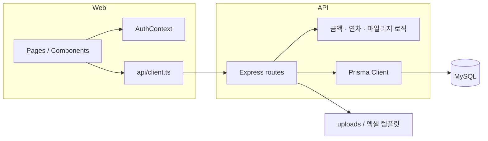

# 아키텍처

업무 ERP를 **SPA + REST + MySQL**로 운영하는 구조입니다.

---

## 레이어



- **웹**: Vite + React 19 + TypeScript. 권한 라우팅은 `RequireAuth` + `minRole`.
- **API**: `server/api.mjs` 단일 Express 앱. Prisma MariaDB 어댑터.
- **계산**: 거래 금액은 프론트 도메인 모듈과 서버 규칙을 맞춰 둡니다.
- **연차 근무일**: 프론트와 서버가 같은 주말·공휴일 규칙을 씁니다.

---

## 권한 모델

```ts
대표 = 3
실장 = 2
차장·과장·대리·주임·사원·직원 = 1
```

`hasAtLeastRole(user, '실장')`처럼 **최소 권한**으로 버튼을 엽니다.  
사용자관리·백업 라우트는 `minRole="대표"`로 막습니다.

세션은 로그인 응답 사용자를 브라우저에 저장하는 방식입니다.

---

## 주요 데이터

| 테이블 | 역할 |
| --- | --- |
| `users` | 계정, 직급, 지점, 서명 |
| `vendors` | 거래처, 마일리지 잔액/요율 |
| `transactions` | 거래 라인, 플래그, 담당자 |
| `mileage_entries` | 적립/사용/수동적립 |
| `leave_requests` / `leave_balances` | 연차 신청, 연도별 부여 |
| `attendance_logs` | 출퇴근 |
| `statement_requests` | 복지/지출 전표 |
| `output_records` | 출력 의뢰 |
| 메시지 큐 테이블 | SMS 발송 상태 |

연차 `days`는 반차 때문에 `Decimal(5,2)`입니다.

---

## API 개요

프론트는 `src/app/api/client.ts`에서 `/api/*`를 호출합니다.

- `POST /api/auth/login`
- `GET/POST/PUT/DELETE /api/users` (리스트에 잔여연차 포함)
- `/api/vendors`, `/api/transactions`, `/api/mileage`
- `/api/leave` (신청·승인, 근무일 정규화)
- `/api/attendance`, `/api/statements`, `/api/outputs`
- 메시지 발송 · 백업 엔드포인트

거래 필터는 **클라이언트**에서 목록을 받은 뒤 적용합니다.  
거래처 `전체(N개)`는 vendor 선택을 제외한 나머지 필터로 걸러진 고유 업체 수입니다.

---

## 프론트 페이지

| 경로 | 페이지 |
| --- | --- |
| `/dashboard` | 홈 |
| `/transactions` | 거래내역 |
| `/vendors` | 거래처 |
| `/outputs` | 출력 |
| `/attendance` | 출퇴근 |
| `/leave` | 연차 |
| `/statements` | 내역서 |
| `/message-management` | 연동 메시지 |
| `/board` | 게시판 |
| `/users`, `/backups` | 대표 전용 |

셸(`AppShell`)에 출퇴근 버튼, 지오펜스, 메뉴 권한 표시가 붙어 있습니다.

---

## 배포

1. `npm run build` → 정적 파일 `dist/`
2. Nginx가 `dist/` 서빙, `/api`는 `127.0.0.1:8787`로 프록시
3. `pm2`로 `node ./server/api.mjs` 상시 실행
4. 업로드는 `uploads/` (git에 포함하지 않음)

로컬은 `npm run dev`가 Vite(5173)와 API(8787)를 같이 띄웁니다.

---

## 이 저장소에 없는 것

- `.env` (DB URL, SMS 키)
- `uploads/` (거래 이미지, 첨부, 영수증)
- 직원 서명 파일
- 운영 정산용 내부 리포트

클론 후 `.env.example`만 채워 로컬에서 올리면 됩니다.
